# Pre-Query Protocol: Data Volume Assessment


```
```mysql> SHOW TABLES;
+-------------------+
| Tables_in_support |
+-------------------+
| cases             |
| clients           |
| transfers         |
| users             |
+-------------------+
4 rows in set (0.01 sec)
```


**For Large Tables (Millions of Rows):** Use _Estimated Counting_ via the Information Schema to protect system stability.

FAST MYSQL

```
SELECT table_name, table_rows 
FROM information_schema.tables 
WHERE table_schema = 'support' 
  AND table_name IN ('cases', 'clients', 'transfers', 'users');


```
```mysql> SELECT table_name, table_rows 
    -> FROM information_schema.tables 
    -> WHERE table_schema = 'support' 
    ->   AND table_name IN ('cases', 'clients', 'transfers', 'users');
+------------+------------+
| TABLE_NAME | TABLE_ROWS |
+------------+------------+
| cases      |          8 |
| clients    |          5 |
| transfers  |     498326 |
| users      |          8 |
+------------+------------+
4 rows in set (0.04 sec)
```
```
```

For Small Tables (Under 100k Rows)

```
SELECT COUNT(*) FROM cases;
SELECT COUNT(*) FROM clients;
SELECT COUNT(*) FROM transfers;
SELECT COUNT(*) FROM users;

```


--------------------

Find Gaps in the Sequence
	
```
mysql> SELECT 
    ->     MIN(transfer_id) AS lowest_id,
    ->     MAX(transfer_id) AS highest_id,
    ->     COUNT(*) AS actual_rows_logged,
    ->     (MAX(transfer_id) - COUNT(*) + 1) AS missing_ids_count
    -> FROM transfers;
+-----------+------------+--------------------+-------------------+
| lowest_id | highest_id | actual_rows_logged | missing_ids_count |
+-----------+------------+--------------------+-------------------+
|         1 |     500000 |             499909 |                92 |
+-----------+------------+--------------------+-------------------+
1 row in set (0.11 sec)

```
####
-----------------------

```mysql
SELECT priority, status, category, opened_at FROM cases;
+----------+--------+-------------+---------------------+

| priority | status | category    | opened_at           |
+----------+--------+-------------+---------------------+

| high     | closed | transport   | 2026-10-01 09:00:00 |
| medium   | open   | portal      | 2026-10-05 10:00:00 |
| high     | closed | network     | 2026-10-06 08:30:00 |
| low      | open   | enhancement | 2026-10-07 13:00:00 |
| high     | open   | transport   | 2026-10-09 07:00:00 |
| medium   | closed | portal      | 2026-10-10 09:00:00 |
| high     | open   | transport   | 2026-10-12 11:00:00 |
| medium   | open   | network     | 2026-10-14 15:00:00 |
+----------+--------+-------------+---------------------+
8 rows in set (0.00 sec)
```


```mysql
SELECT * FROM cases LIMIT 2;
+---------+-----------+---------------------+---------------------+----------+-----------+--------+------------------------+

| case_id | client_id | opened_at           | closed_at           | priority | category  | status | subject                |
+---------+-----------+---------------------+---------------------+----------+-----------+--------+------------------------+

|       1 |         1 | 2026-10-01 09:00:00 | 2026-10-01 15:00:00 | high     | transport | closed | SFTP login failing     |
|       2 |         1 | 2026-10-05 10:00:00 | NULL                | medium   | portal    | open   | Portal slow on reports |
+---------+-----------+---------------------+---------------------+----------+-----------+--------+----------------------+
2 rows in set (0.00 sec)
```


---

# ORDER BY


Everything is sorted by ascending by default.
`ORDER BY '' DESC;`


Tip: Default is ascending, so no need to type `ASC`.


# where 10

# SELECT COUNT
* TRANSFERS IS TABLE
```
mysql> SELECT COUNT(*) FROM transfers;
+----------+
| COUNT(*) |
+----------+
|   499909 |
+----------+
1 row in set (0.09 sec)

```


---
# WHERE
* `WHERE != 24` (not equal)  
* `WHERE <= 24` (less than or equal)  
* `WHERE id BETWEEN 25 AND 30` (self-explanatory)  

For text:
```mysql
SELECT protocol FROM transfers WHERE protocol = 'SFTP';  
```


# ADVANCED FILTERING IN AND OR


* cases = tables, priority /category = columns, high/transport = data value, 
```mysql
SELECT * FROM cases WHERE priority = 'high' AND category = 'transport';
+---------+-----------+---------------------+---------------------+----------+-----------+--------+----------------------+

| case_id | client_id | opened_at           | closed_at           | priority | category  | status | subject              |
+---------+-----------+---------------------+---------------------+----------+-----------+--------+----------------------+

|       1 |         1 | 2026-10-01 09:00:00 | 2026-10-01 15:00:00 | high     | transport | closed | SFTP login failing   |
|       5 |         4 | 2026-10-09 07:00:00 | NULL                | high     | transport | open   | AS2 receipts missing |
|       7 |         2 | 2026-10-12 11:00:00 | NULL                | high     | transport | open   | Files stuck in queue |
+---------+-----------+---------------------+---------------------+----------+-----------+--------+----------------------+
```


# MySQL Database Tutorial - 12 - Are you IN or are you NOT IN?
* name,state =  COLUMNS, customer = TABLES,  CA NC NY = data values


select all * 
```
mysql> SELECT * FROM cases;
+---------+-----------+---------------------+---------------------+----------+-------------+--------+---------------------------+
| case_id | client_id | opened_at           | closed_at           | priority | category    | status | subject                   |
+---------+-----------+---------------------+---------------------+----------+-------------+--------+---------------------------+
|       1 |         1 | 2026-10-01 09:00:00 | 2026-10-01 15:00:00 | high     | transport   | closed | SFTP login failing        |
|       2 |         1 | 2026-10-05 10:00:00 | NULL                | medium   | portal      | open   | Portal slow on reports    |
|       3 |         2 | 2026-10-06 08:30:00 | 2026-10-08 12:00:00 | high     | network     | closed | VPN tunnel drops          |
|       4 |         3 | 2026-10-07 13:00:00 | NULL                | low      | enhancement | open   | Request: CSV export       |
|       5 |         4 | 2026-10-09 07:00:00 | NULL                | high     | transport   | open   | AS2 receipts missing      |
|       6 |         4 | 2026-10-10 09:00:00 | 2026-10-11 09:00:00 | medium   | portal      | closed | Password reset loop       |
|       7 |         2 | 2026-10-12 11:00:00 | NULL                | high     | transport   | open   | Files stuck in queue      |
|       8 |         5 | 2026-10-14 15:00:00 | NULL                | medium   | network     | open   | Cannot reach SFTP port 22 |
+---------+-----------+---------------------+---------------------+----------+-------------+--------+---------------------------+
8 rows in set (0.01 sec)

mysql> SHOW TABLES;
+-------------------+
| Tables_in_support |
+-------------------+
| cases             |
| clients           |
| transfers         |
| users             |
+-------------------+
4 rows in set (0.00 sec)
```


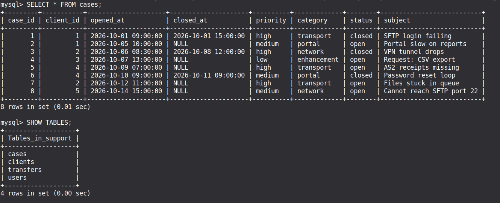


# 16 - Creating Custom Columns


CONCAT or join things together
	*  SELECT CONCAT(email, ', ',status) FROM users; *
	*  email, status = COLUMNS of users(table)
	```
```

mysql> SELECT * FROM users;
+---------+-----------+-------------------+----------+---------------------+
| user_id | client_id | email             | status   | last_login          |
+---------+-----------+-------------------+----------+---------------------+
|       1 |         1 | ops@acme.com      | active   | 2026-10-14 08:00:00 |
|       2 |         1 | it@acme.com       | locked   | 2026-09-01 10:00:00 |
|       3 |         2 | admin@birch.org   | active   | 2026-10-15 09:30:00 |
|       4 |         3 | dev@cobalt.com    | active   | 2026-10-10 14:00:00 |
|       5 |         3 | ap@cobalt.com     | disabled | NULL                |
|       6 |         4 | noc@delta.net     | active   | 2026-10-16 07:45:00 |
|       7 |         5 | it@evergreen.com  | active   | 2026-08-20 11:00:00 |
|       8 |         2 | billing@birch.org | active   | 2026-10-12 16:20:00 |
+---------+-----------+-------------------+----------+---------------------+
8 rows in set (0.00 sec)

ERROR: 
No query specified

**mysql> SELECT CONCAT(email, ', ',status) FROM users;**
+----------------------------+
| CONCAT(email, ', ',status) |
+----------------------------+
| ops@acme.com, active       |
| it@acme.com, locked        |
| admin@birch.org, active    |
| dev@cobalt.com, active     |
| ap@cobalt.com, disabled    |
| noc@delta.net, active      |
| it@evergreen.com, active   |
| billing@birch.org, active  |
+----------------------------+
8 rows in set (0.00 sec)


```

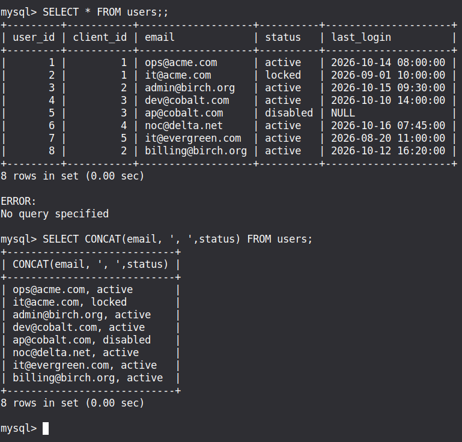

```
mysql> SELECT CONCAT(email, ', ',status)AS custom_column FROM users;
+---------------------------+
| custom_column             |
+---------------------------+
| ops@acme.com, active      |
| it@acme.com, locked       |
| admin@birch.org, active   |
| dev@cobalt.com, active    |
| ap@cobalt.com, disabled   |
| noc@delta.net, active     |
| it@evergreen.com, active  |
| billing@birch.org, active |
+---------------------------+
8 rows in set (0.00 sec)

```


```
SELECT name, cost, cost-1 AS sale_price FROM items;
```

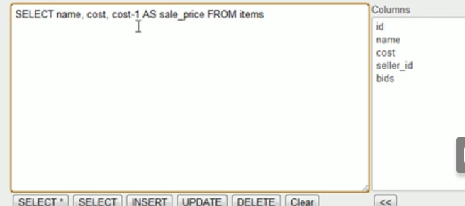

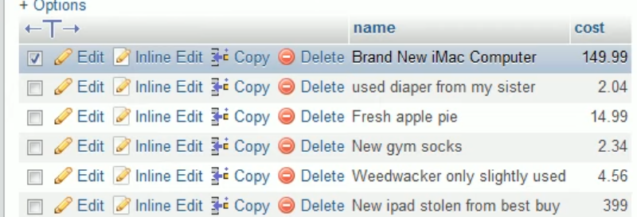

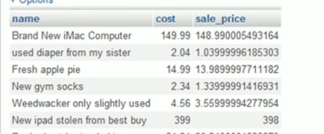


#17 functions - after a funcion next is parenthesis - UPPER(),CONCAT()

```
mysql> SELECT email, UPPER(email) AS ALLCAPS_CUSTOM_COLUMN FROM users;
+-------------------+-----------------------+
| email             | ALLCAPS_CUSTOM_COLUMN |
+-------------------+-----------------------+
| ops@acme.com      | OPS@ACME.COM          |
| it@acme.com       | IT@ACME.COM           |
| admin@birch.org   | ADMIN@BIRCH.ORG       |
| dev@cobalt.com    | DEV@COBALT.COM        |
| ap@cobalt.com     | AP@COBALT.COM         |
| noc@delta.net     | NOC@DELTA.NET         |
| it@evergreen.com  | IT@EVERGREEN.COM      |
| billing@birch.org | BILLING@BIRCH.ORG     |
+-------------------+-----------------------+
8 rows in set (0.00 sec)

```


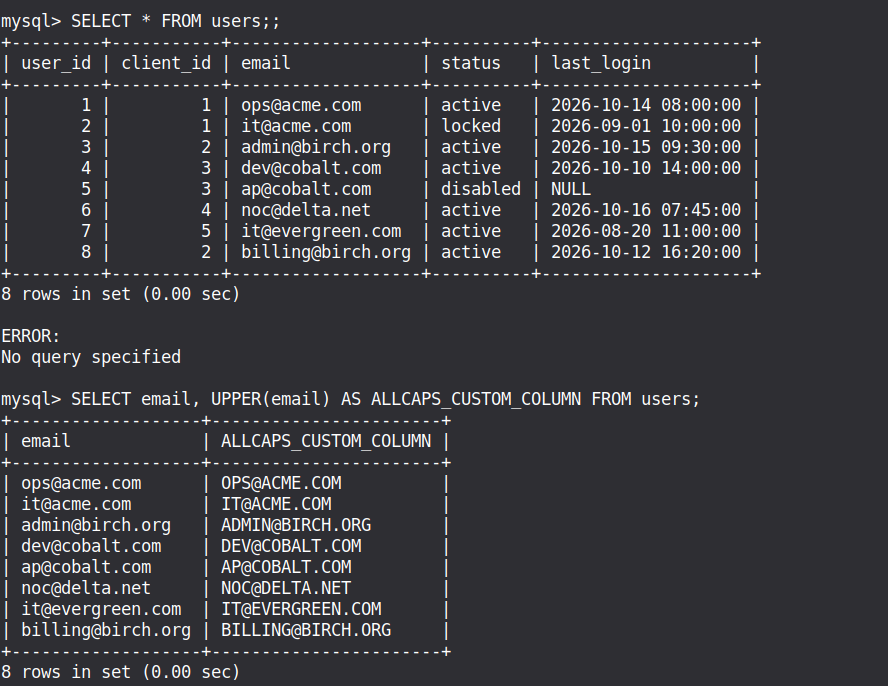


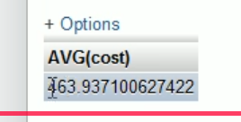


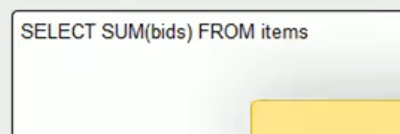


# 18 aggregate functions

RAW TABLE DATA / TABLE RECORDS
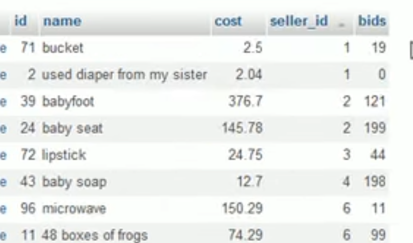

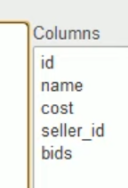
cost = columns, items= tables
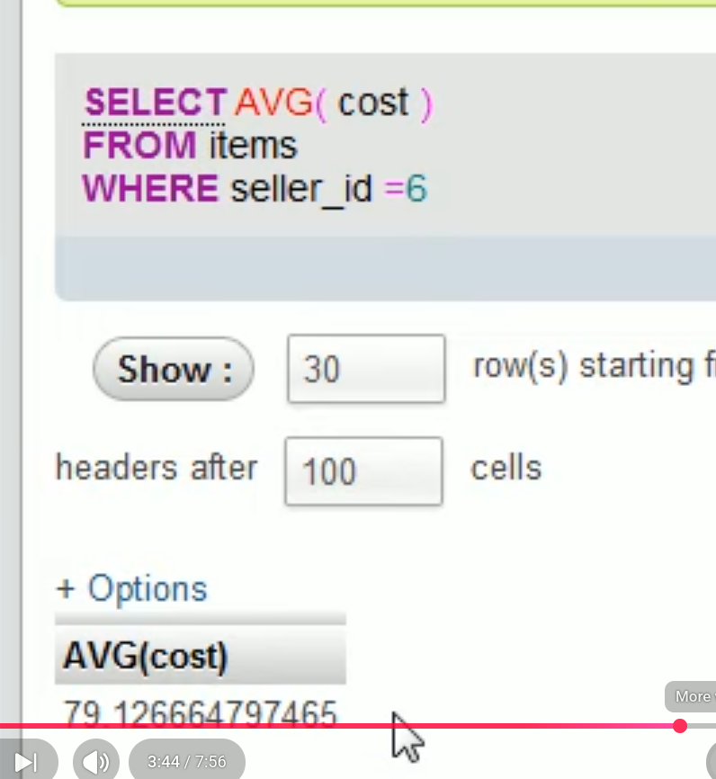


```
SELECT COUNT (*) AS item_count MAX(cost ) AS max, AVG(cost) AS avg FROM items  WHERE seller_id=12
```
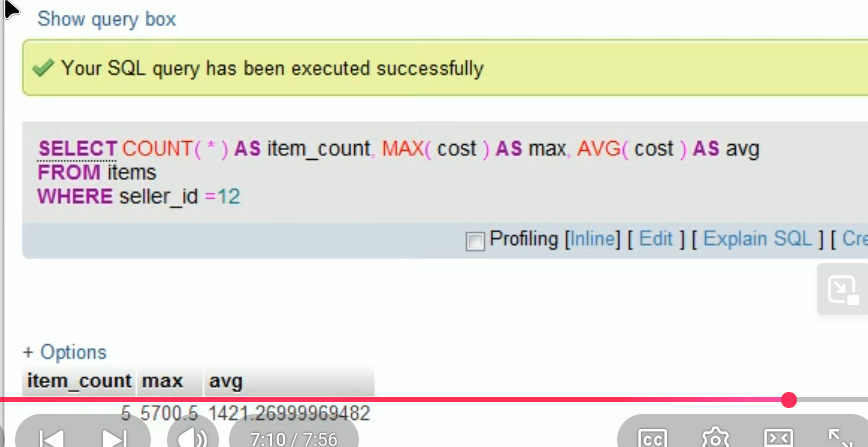


# 19 group by

```
mysql> SELECT * FROM cases;
+---------+-----------+---------------------+---------------------+----------+-------------+--------+---------------------------+
| case_id | client_id | opened_at           | closed_at           | priority | category    | status | subject                   |
+---------+-----------+---------------------+---------------------+----------+-------------+--------+---------------------------+
|       1 |         1 | 2026-10-01 09:00:00 | 2026-10-01 15:00:00 | high     | transport   | closed | SFTP login failing        |
|       2 |         1 | 2026-10-05 10:00:00 | NULL                | medium   | portal      | open   | Portal slow on reports    |
|       3 |         2 | 2026-10-06 08:30:00 | 2026-10-08 12:00:00 | high     | network     | closed | VPN tunnel drops          |
|       4 |         3 | 2026-10-07 13:00:00 | NULL                | low      | enhancement | open   | Request: CSV export       |
|       5 |         4 | 2026-10-09 07:00:00 | NULL                | high     | transport   | open   | AS2 receipts missing      |
|       6 |         4 | 2026-10-10 09:00:00 | 2026-10-11 09:00:00 | medium   | portal      | closed | Password reset loop       |
|       7 |         2 | 2026-10-12 11:00:00 | NULL                | high     | transport   | open   | Files stuck in queue      |
|       8 |         5 | 2026-10-14 15:00:00 | NULL                | medium   | network     | open   | Cannot reach SFTP port 22 |
+---------+-----------+---------------------+---------------------+----------+-------------+--------+---------------------------+
8 rows in set (0.04 sec)

mysql> SELECT priority, COUNT(*) AS category_count FROM cases GROUP BY priority;
+----------+----------------+
| priority | category_count |
+----------+----------------+
| high     |              4 |
| medium   |              3 |
| low      |              1 |
+----------+----------------+
3 rows in set (0.01 sec)

```


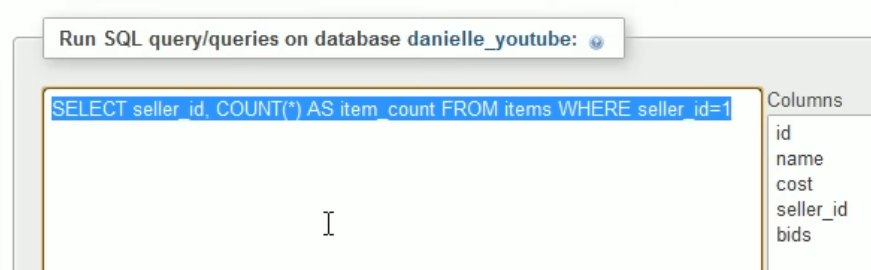


```
mysql> SELECT user_id, COUNT(*) AS item_count FROM users GROUP BY user_id;
+---------+------------+
| user_id | item_count |
+---------+------------+
|       1 |          1 |
|       2 |          1 |
|       3 |          1 |
|       4 |          1 |
|       5 |          1 |
|       6 |          1 |
|       7 |          1 |
|       8 |          1 |
+---------+------------+
8 rows in set (0.01 sec)


```
HAVING


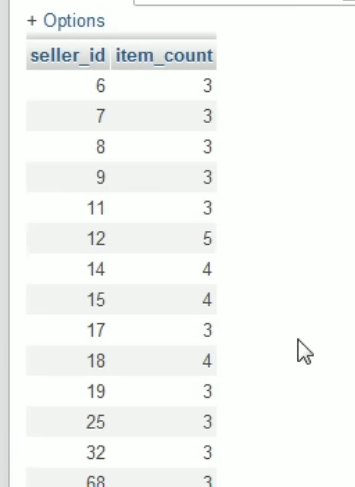


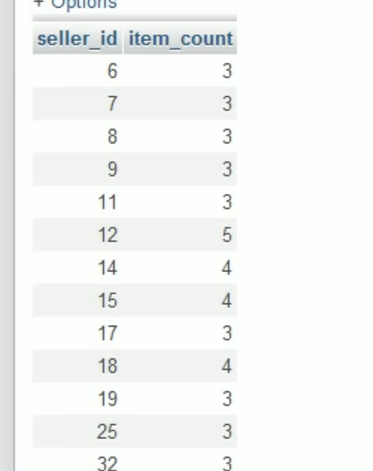


```
mysql> SELECT * FROM cases;
+---------+-----------+---------------------+---------------------+----------+-------------+--------+---------------------------+
| case_id | client_id | opened_at           | closed_at           | priority | category    | status | subject                   |
+---------+-----------+---------------------+---------------------+----------+-------------+--------+---------------------------+
|       1 |         1 | 2026-10-01 09:00:00 | 2026-10-01 15:00:00 | high     | transport   | closed | SFTP login failing        |
|       2 |         1 | 2026-10-05 10:00:00 | NULL                | medium   | portal      | open   | Portal slow on reports    |
|       3 |         2 | 2026-10-06 08:30:00 | 2026-10-08 12:00:00 | high     | network     | closed | VPN tunnel drops          |
|       4 |         3 | 2026-10-07 13:00:00 | NULL                | low      | enhancement | open   | Request: CSV export       |
|       5 |         4 | 2026-10-09 07:00:00 | NULL                | high     | transport   | open   | AS2 receipts missing      |
|       6 |         4 | 2026-10-10 09:00:00 | 2026-10-11 09:00:00 | medium   | portal      | closed | Password reset loop       |
|       7 |         2 | 2026-10-12 11:00:00 | NULL                | high     | transport   | open   | Files stuck in queue      |
|       8 |         5 | 2026-10-14 15:00:00 | NULL                | medium   | network     | open   | Cannot reach SFTP port 22 |
+---------+-----------+---------------------+---------------------+----------+-------------+--------+---------------------------+
8 rows in set (0.00 sec)

mysql> SELECT priority, COUNT(*) AS category_count FROM cases GROUP BY priority;
+----------+----------------+
| priority | category_count |
+----------+----------------+
| high     |              4 |
| medium   |              3 |
| low      |              1 |
+----------+----------------+
3 rows in set (0.00 sec)

mysql> SELECT priority, COUNT(*) AS category_count FROM cases GROUP BY priority HAVING COUNT(*)>=3 ;
+----------+----------------+
| priority | category_count |
+----------+----------------+
| high     |              4 |
| medium   |              3 |
+----------+----------------+
2 rows in set (0.00 sec)

```

HAVING COUNT(*)  >=3   MEANS  3 or more items

```
mysql> SELECT priority, COUNT(*) AS category_count FROM cases GROUP BY priority HAVING COUNT(*)>=3 ORDER BY category_count DESC;
+----------+----------------+
| priority | category_count |
+----------+----------------+
| high     |              4 |
| medium   |              3 |
+----------+----------------+
2 rows in set (0.01 sec)

mysql> SELECT priority, COUNT(*) AS category_count FROM cases GROUP BY priority HAVING COUNT(*)>=3 ORDER BY category_count 
    -> ;
+----------+----------------+
| priority | category_count |
+----------+----------------+
| medium   |              3 |
| high     |              4 |
+----------+----------------+
2 rows in set (0.00 sec)

```

------------------
# impt data manipulation


TOTAL
Add a Total Row to the Bottom

```
SELECT client_id, COUNT(*) AS client_id_count 
FROM transfers 
GROUP BY client_id WITH ROLLUP;


```
# 2 show the unique value in a column
SELECT DISTINCT status FROM transfers;
```
mysql> SELECT DISTINCT status FROM transfers;
+--------+
| status |
+--------+
| OK     |
| FAILED |
+--------+
2 rows in set (0.36 sec)

```

# 3 unique value with count

```
mysql> SELECT status, COUNT(*) AS status_count 
    -> FROM transfers 
    -> GROUP BY status;
+--------+--------------+
| status | status_count |
+--------+--------------+
| OK     |       449914 |
| FAILED |        49995 |
+--------+--------------+
2 rows in set (0.48 sec)

```


------------------------
# 20 SUBQUERIES
# 21 
```
SELECT seller_id 
FROM items
WHERE name LIKE'%boxes of frogs'
LIMIT 0, 30;
```

% wildcard= The `%` symbol is a wildcard that allows any text (or no text) to exist before that phrase

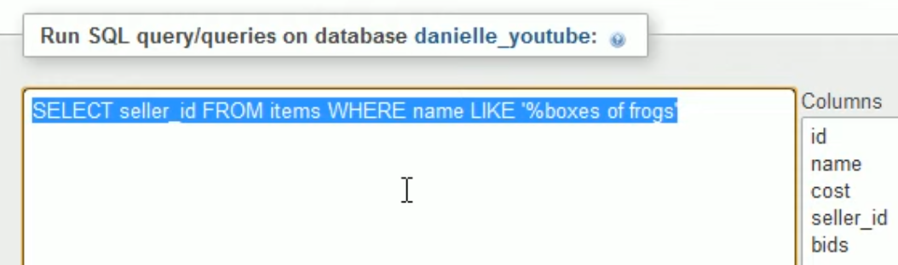
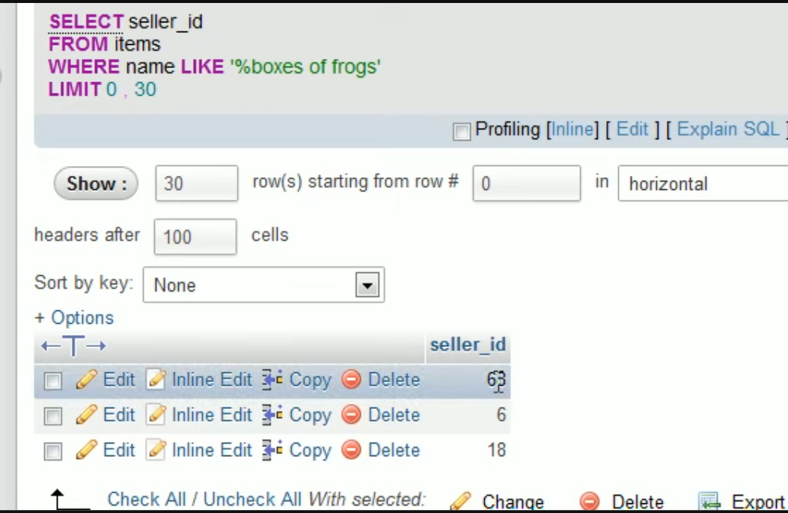

full table


* impt notes* whenever use IN it is a list

```
SELECT name, MIN(cost) FROM items WHERE name LIKE '%boxes of frogs' AND seller_id IN(68,4,1)
```
vs subquery

```
SELECT name, MIN(cost) FROM items WHERE name LIKE '%boxes of frogs' AND seller_id IN(

SELECT seller_id 
FROM items
WHERE name LIKE'%boxes of frogs'
)
```

# 22 join - tables

# safe sequence

SHOW TABLES;

```
mysql> SHOW TABLES;
+-------------------+
| Tables_in_support |
+-------------------+
| cases             |
| clients           |
| transfers         |
| users             |
+-------------------+
4 rows in set (0.01 sec)

```

```
mysql> SHOW COLUMNS FROM transfers;
+-------------+--------------+------+-----+---------+-------+
| Field       | Type         | Null | Key | Default | Extra |
+-------------+--------------+------+-----+---------+-------+
| transfer_id | int          | NO   | PRI | NULL    |       |
| client_id   | int          | YES  |     | NULL    |       |
| protocol    | varchar(10)  | YES  |     | NULL    |       |
| filename    | varchar(100) | YES  |     | NULL    |       |
| status      | varchar(10)  | YES  |     | NULL    |       |
| bytes       | bigint       | YES  |     | NULL    |       |
| started_at  | timestamp    | YES  |     | NULL    |       |
| error_code  | varchar(10)  | YES  |     | NULL    |       |
+-------------+--------------+------+-----+---------+-------+
8 rows in set (0.01 sec)

```

```
mysql> SELECT COUNT(*) AS total_rows FROM transfers;
+------------+
| total_rows |
+------------+
|     499909 |
+------------+
1 row in set (0.17 sec)

```


